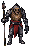

# Hollows and Other Creatures

Hollows are the walking dead: bodies whose souls went into stones. Most are walked by loose souls from stones broken in the war; killing one only lays it down, and after a long while it rises again in the same body. Burning stops the body but sends the soul looking for another, which is how the Misborn are made. Only binding catches the soul. Others are hatred Hollows, Grudge's leftovers from an uttered rune, which burn in ember and stay dead. Every enemy is a Hollow of some kind (round 49).

## Canon

- **Monsters were once human or animal.** (seen in: ART_RULES §7)
- **Hollows:** husks of dead soldiers. Slow; they lunge with a spear thrust, telegraphed by the body flashing ember and the thrust's wind-up (no warning on the ground). A slain Hollow leaves its body, which can be searched. (seen in: enemies.js, body prop)
- **Their souls went into the stones,** first under the false rites, then harvested in the war. That makes them hollow. (rounds 2–4, 7)

### Two kinds (round 10)

- **Loose-soul Hollows:** a loose soul from a stone broken unspoken (in the war, or a failed fuse) walks a dead body. Most Hollows on the old fields. They look as they do now (enemies.js). Also: a cut-short rite with no blank leaves the soul loose (round 36).
- **Hatred Hollows:** a soul burned by an utterance raises one nearby; strength scales with the spell. It is what Grudge didn't finish eating: the kept coal (round 37). Traits (round 13):
  - **No name left** (the utterance spent it); nothing to bind; only fought. (rounds 11, 13)
  - **Once killed, it stays dead.**
  - **Rises burning at the seams in ember,** never tier color, so it isn't rune-touched and drops no rune.
  - **No searchable body** (proposed: "Nothing but ash.").
  - **Strength set by which corpse the hatred seizes:** a Pale utterance stirs a peasant's bones, a Gold one drags a knight from the mud.
  - **Built (round 48;** seen in: godot/scripts/hollow.gd `hatred`, godot/scripts/game/utter.gd raise_hatred, RuneBook.HATRED_HP / HATRED_DAMAGE): rises on every utterance, climbing out of the ground near him; health and blow grow with the uttered stone's tier (up to 4x health, 2x blow at Gold); ember sparks at the seams; an empty stone can't bind it; it falls to ash and leaves no body; it stays dead. *Simplification:* the corpse it seizes (peasant to knight) isn't shown; it uses the normal Hollow sprite. Inside a village it rises too, but the Hollow barrier keeps it from chasing (see [Uttering](../Mechanics/uttering.md) Open).

### Loose souls (rounds 8–10, 13, 15)

- **Souls from runes broken without being spoken,** adrift between the afterlife and a body. **They fill most Hollows.** Uttered souls are burned and never loose.
- **A loose soul takes the nearest unburned corpse** (round 15).
- **Kill: the body is laid down, the soul stays in it** (round 49; replaces round 15's "walks again in a corpse that hasn't risen yet"). After a long window it **rises again in the same body**, the one it already holds.
  - **Killing a Hollow adds no corruption.** (round 15)
  - **A risen corpse carries only what it still had.** A searched body rises empty. (round 15)
  - **A laid-down body still holding a soul gives a breath.** It is the tell that it can be bound. (round 49; renamed from "faint whisper" round 49b so it isn't confused with the Whisper)
  - **How long the window lasts is tuning.** In the prologue the dead rise again quickly. (round 49b)
  - **A Hollow takes the Wanderer's dropped bag** if he dies again before reaching it (round 24); hatred Hollows never do.
- **Burn: the only way to stop a body for good** (round 49). **Burned bodies do not walk** (round 18). But the soul is not freed: it goes loose and takes, in order:
  1. **the nearest unrisen man's corpse;**
  2. with none left, **a beast's corpse** (the Misborn, below);
  3. with no corpse at all, it **drifts**, unseen.
  - **Burning to protect a place is what breeds Misborn.** (round 49)
  - **Gled's burning does not breed Misborn:** neither her rite nor her buff. (round 49b; why: open question in Open)
- **A beast's soul never takes a man's body.** (round 49) **Loose animal souls walk animal corpses** (round 34): a beast stone broken unspoken looses a beast soul.
- **Bind:** at a laid-down body, before it rises, the Wanderer traps the soul in a blank. See [Rebuilding and binding](../Runes/rebuilding-and-binding.md). (round 49)
- **Design intent** (round 49): laying a Hollow down is enough to pass through; blanks are scarce, so binding is a choice; rites are done in batches at villages; **an area whose souls are all bound or burned is "at rest".**
- **A soldier's soul is freed only when his rune is given back to a good god;** uttering it destroys him. (round 7)
- **Binding by name** (round 13) is for souls that have drifted away; at a laid-down body the soul is present and needs no name (proposed reconciliation, see Open). Results: see [Rebuilding and binding](../Runes/rebuilding-and-binding.md).
- **Names come from kin,** and rarely from a **rite cord** tied at the dying man's wrist (round 19); its knots are a number looked up in a chapel ledger or with a monk.
- **Dark monks lie about rite cords by swapping** (round 15, C1): asked to read a cord, a dark monk gives another real dead man's ledger name and keeps the true one. Scripted, from game state.
  - **Found out** by reading the bound rune (wrong man) and checking the cord in a Chapel Ruins ledger.
  - **He lies to the clean and stops lying near madness.**
  - **The swapped name can be a living villager's** (C2, round 21; see [The living binding](../Mechanics/the-living-binding.md)).
- **Clue names never lie, even during the Whisper** (round 15): ledger lines, cord readings and binding names are exact game strings. (A dark monk's swap is a character's lie.) Narrowed round 20: names only; echoes can be misheard.

### The Misborn (round 49)

- **A man's soul in a beast's corpse,** taken only when no man's corpse is left. The one described: a **dead warhorse forced upright,** forelegs swung like arms, joints snapped to bend like knees, a dented helmet rammed on its skull. It **screams in a man's voice** and **says one word when it dies.**
- Made mostly by burning: the more a place burns its Hollows, the more Misborn walk near it.

### Others

- **All enemies are Hollows in different bodies:** men, beasts and the Misborn. (round 49) **Most bosses are Hollows too; the keepers and the Unfallen, who are alive, are the exceptions.** (round 49b)
- **Rune-corrupted creatures** show their rune's tier color in eyes, veins or an embedded rune, and drop a rune of that tier. (ART_RULES §7; not in game yet)
- **The Unfallen,** the Crimson prisoners: see [The Unfallen](the-unfallen.md).

## Open

- **Round 49 flags still open:**
  - **Why does Gled's fire breed no Misborn?** (open question, round 49b) [Plain fire only burns the body, so the soul grabs the next one. Gled's fire is said over, and "what burns is free of the hand": it cuts the soul's grip on any flesh. Not freed (only Wend's road frees); it drifts until bound by name. Her fire puts a place at rest; plain fire only moves the trouble.]
  - **ART_RULES §7's rune-corrupted creatures** (glowing eyes, drop a rune): which Hollows are they? Proposal: Hollows walking a body that still carries a stone (a lashed blade, a yoke).
  - **The Misborn's one word** and **whether a Misborn can be bound, and what its stone would be:** open; the user hasn't decided how beast runes work (round 49b). Note: forced wire comes from the dead man's own mail, and a horse has none.
  - **Can the soul choose?** Rising in the same body is "convenient for the soul"; does a soul ever leave a laid-down body by itself? Proposal: no, only fire moves it.
- ~~Can a man's loose soul take a beast's body, or the reverse?~~ Settled round 49: yes, only with no man's corpse left; never the reverse.
- ~~Corpse budget under persistence~~ Settled round 49: killing uses up no corpse (same body); only burning moves souls on.
- **Ten years in the open leaves bones, not husks** (round 32 note). Proposal: a body walked by a loose soul doesn't rot fully (it is held); unwalked dead go to bone.
- **Grudge-rite Hollows:** see [Grudge](../Gods/grudge.md).
- **"Climbs out of the ground" vs "seizes the nearest corpse"** (round 48 flag). Fine on the fields, where the war dead lie under the turf. Inside a village the dead are burned, so there is nothing below to climb out of. Proposal: villages stand on old fields too, and the wall was built over the unburned dead of the war; or the hatred Hollow rises past the wall like the Grudge rite's.

## Rejected

- **Hollows lost their names only to become a kind** (round 2 option 1) and **every Hollow keeps a name too faded to read** (option 3). Rejected round 3: the names went into the stones.
- **Loose-soul options rejected round 15:** **B2** a body like its own (soldier to soldier; extra rule for little gain); **B3** killing ends it (makes binding pointless, empties fields too fast); **B1 alone** killing looses the soul again at once (endless respawn).
- **Round 15's "walks again in a corpse that hasn't risen yet"** after a kill. Superseded round 49: it rises in the same body; only burning moves it to another.
- **"Nearest of its kind" only** (round 15 proposal). Superseded round 49: a man's soul takes a beast when no man's corpse is left.
- **Dark monk lie options rejected round 15:** **C3** ordinary monks misread rotted cords too (muddies the clue); **C4** dark monks never lie, only withhold (too weak a tell).
