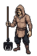
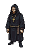
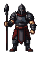
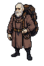

# Villagers

The people behind the stockades: peasants, monks, guards and one barterer per village. Poor, tired and walled in. Some of the monks secretly serve the dark gods. What villagers say is a claim, not proven truth.

   

## Canon

- **Villagers:** peasants, monks, guards. Walled in, poor, tired. One barterer per village. (seen in: village.js)
- **Village monks** are the carvers who rebuild runes for metal (design canon) and live on the rite fee (round 23). Which of them are dark is hidden. See [The Order](../Organizations/the-order.md) and [Keepers](../Organizations/keepers.md).
- **Persist once generated, with the same people; each can remember the Wanderer.** (round 8)
- **Lines in the game** (claims; seen in: village.js):
  - peasant: "My son went to the battlefield. The crows came back." / "The crows eat better than we do." / "Don't drink from the well after dark."
  - monk: "The runes remember what we forget." / "Pray if you like. Nothing listens." / "Every stone out there was once a promise."
  - guard: "Walls won't hold forever. Neither will I." / "Keep your blade low inside the walls." / "Seen worse than you come through that gate."
- **Crows** are everywhere in villager talk. (claim)
- **Faith has failed, at least for some** (monk). Half true: the good gods are too weak to answer; the dark ones listen.

### Dialogue (round 9 idea; lore rules round 10)

- **Dialogue from a small language model** (design idea, not lore canon): trained on English and this lore; each villager holds only a prompt template with guardrails. The engineering isn't judged here.
- The **dialogue lore rules** are in the [README](../README.md#ground-rules).

## Open

- **Circle survivors as rare village NPCs** (round 35 proposals), taken for mad:
  - From the stone-sick: the real stone-sick died or wasted; a survivor is old and whole, and his ramblings carry exact game strings (a name piece, a milestone mark, a ledger page) that check out.
  - From the first-boss keeper: the keeper raves about feeding ("I fed them."); the survivor about doors and holding ("She's still holding it.").
  - From dark monks: dark monks warm to an offerer; a survivor goes cold and stops talking.
  - Lines: peasant: "Old Teodor talks to the milestones. Leave him be." (placeholder name); survivor: "Six doors. Five still shut. Don't knock."
- **Burning lines** (round 14 proposal; the burning itself is canon from round 39, see [Villages](../Locations/villages.md)): peasant: "We burn ours. Others weren't so lucky."; guard on the field: "Nobody burned them. Nobody had the time."
- **Survivors of the chapels' fall** (round 29): see [Chapel Ruins](../Locations/chapel-ruins.md).
- **Old soldier lines:** see [Reading and echoes](../Mechanics/reading-and-echoes.md) and [The crowns and heirs](../Organizations/the-crowns-and-heirs.md).
